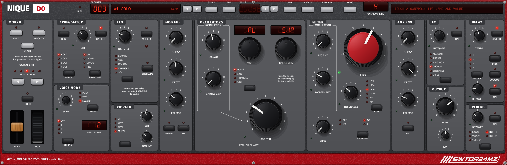
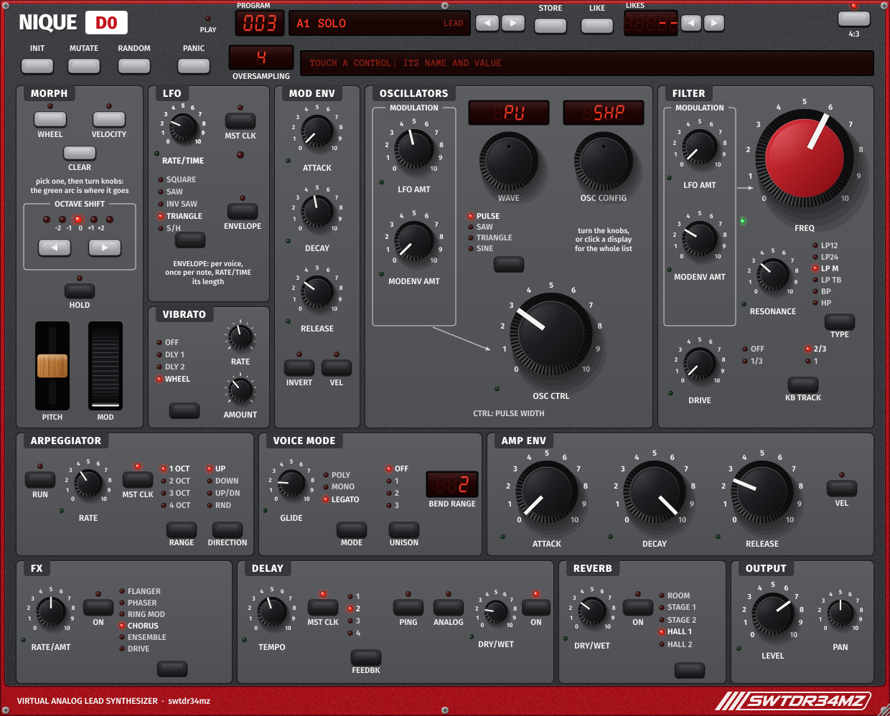

# NIQUE D0

A virtual-analogue lead synthesizer as a plugin: **VST3** and **AU** for the Mac (Apple Silicon and Intel in one
file), **VST3** for Windows, and a **standalone app** for both. After the idea of the Nord Lead A1. By
**swtdr34mz**.



The **4:3** key (top right) lays the panel out for smaller screens: the vibrato goes under the LFO, the arpeggiator,
voice mode, amp envelope and the effects lie down in two rows below the oscillators and the filter; the key again goes back.



One synth part with 24 voices (in a DAW: one instance per part, instead of the A1's four slots):

- **OSCILLATORS:** 47 waveforms: PULSE, SAW, TRI, SINE; A1–A7 (extended analogue); P1–P3 (fixed pulse widths);
  O1–O9 (drawbar organs); B1–B5 (bells and metal bars); D1–D8 (digital spectra); E1–E4 (e-pianos, clavinets);
  F1–F7 (vowels). The **OSC CONFIG** picks what **OSC CTRL** does: PITCH, SHAPE (pulse width, a second saw, wave
  folding, phase distortion), SYNC, DETUNE (cents, then semitones), the MIXES (a sine, triangle, saw or square on
  a harmonic: SUB, 1–8), FM (a sine at 13 ratios), AM, NOISE. **LFO AMT** and **MODENV AMT** move OSC CTRL.
  Turn the endless knobs, or click a display for the whole list.
- **FILTER:** LP12, LP24, LP M (transistor ladder), LP TB (diode ladder: no self-oscillation, less resonance down
  low), BP, HP; FREQ, RESONANCE, DRIVE, KB TRACK (off, 1/3, 2/3, 1), LFO AMT, MODENV AMT.
- **MOD ENV / AMP ENV:** attack, decay, release; the decay at its end holds (ASR). INVERT and VEL for the mod
  envelope, VEL for the amp envelope.
- **LFO:** square, saw, inverted saw, triangle, S/H; MST CLK (the DAW's tempo, 4 bars to 1/64, triplets);
  ENVELOPE: once per note, per voice. Its amount is set in the oscillators (LFO AMT) and the filter (LFO AMT).
- **VOICE MODE:** poly, mono, legato, UNISON 1–3, GLIDE, BEND RANGE (to 48 semitones, or +2/-12, +2/-24).
  **VIBRATO:** DLY 1, DLY 2 (starting after 0.5 / 1 s) or WHEEL, its RATE and AMOUNT.
- **ARPEGGIATOR:** RUN, RATE (or MST CLK: 1/2 to 1/32, triplets), RANGE 1–4 octaves, up, down, up/down, random.
  **HOLD** holds the notes (a new chord replaces them). **OCTAVE SHIFT** ±2.
- **FX:** flanger, phaser, ring mod, chorus, ensemble, drive (RATE/AMT). **DELAY:** TEMPO (or MST CLK, dotted,
  triplets, swing), 4 feedback steps, PING PONG, ANALOG (the echoes bend when the time changes), DRY/WET.
  **REVERB:** room, stage 1 and 2, hall 1 and 2. **OUTPUT:** level, pan.
- **MORPH:** pick WHEEL or VELOCITY, then turn knobs: the green arc shows where the mod wheel (or a hard key)
  takes each one. 25 parameters can morph. CLEAR clears the morph picked.
- **MUTATE / RANDOM:** a near relative of the sound / anything at all. With a morph picked they make a morph.
  **LIKE** keeps the sound as it is now (up to 50, kept with the project); the arrows go back to them.
  **INIT** starts from a plain saw. **STORE** saves your own presets (Documents/NIQUE D0/Presets).

**Sound:** the voices run at 4 times the host's rate (OVERSAMPLING: 2x light on the CPU, 4x, 8x for the final
mix; half that from 88.2 kHz up), down through half-band filters. Each voice drifts a few cents and has its own
tuning and filter offset, the envelopes attack like a charging capacitor, the ladders self-oscillate (the diode
ladder never), and every knob move is smoothed. The effects read their delay lines with cubic interpolation.

57 factory programs: leads, basses, pads, strings, brass, keys, organs, bells, plucks, voices, arpeggios, effects.

## Installing on the Mac

1. Download `NIQUED0-macOS.zip` (under *Actions* → the latest run → *Artifacts*, or under *Releases*) and unzip it.
2. Copy the plugins into these folders (in Finder: *Go* → *Go to Folder…*, paste the path):
   - `NIQUE D0.vst3` to `~/Library/Audio/Plug-Ins/VST3`
   - `NIQUE D0.component` to `~/Library/Audio/Plug-Ins/Components`
3. The plugin is not registered with Apple, so macOS blocks it at first ("damaged" or "cannot be opened"). Open
   *Terminal* (in *Applications* → *Utilities*), paste this line and press Return:

   ```
   xattr -dr com.apple.quarantine ~/Library/Audio/Plug-Ins/VST3/NIQUE\ D0.vst3 ~/Library/Audio/Plug-Ins/Components/NIQUE\ D0.component
   ```

4. Start Ableton Live. In *Settings* → *Plug-Ins*, turn on *Use Audio Units v2* and/or *Use VST3 Plug-ins (System
   Folders)*, then *Rescan*. NIQUE D0 is under *Plug-ins* → *swtdr34mz*.

## Installing on Windows

Unzip `NIQUED0-Windows.zip` and copy `NIQUE D0.vst3` to `C:\Program Files\Common Files\VST3`. The standalone app
`NIQUE D0.exe` runs without a DAW.

**Linux (Bitwig, Reaper, Ardour, ...):** Die `.tar.gz` entpacken. `NIQUE D0.vst3` nach `~/.vst3/` kopieren, `NIQUE D0.lv2` nach `~/.lv2/`. Die App `NIQUE D0` startet auch ohne DAW. 64 Bit, gebaut auf Ubuntu 22.04.

## Building

```
cmake -B build -DCMAKE_BUILD_TYPE=Release
cmake --build build --config Release
```

JUCE 8 comes from GitHub (or `-DNQ_JUCE_DIR=/path/to/JUCE`). The engine's tests run without JUCE:
`cmake -S tests -B build-tests && cmake --build build-tests && build-tests/engine_tests`.
GitHub Actions builds Windows and the Mac on every push (the zips are the run's *Artifacts*; a tag `v*` puts them
in a release).

Code: MPL-2.0. Fonts: Fira Sans, Anonymous Pro (SIL OFL). NIQUE D0 is an independent project, not affiliated with
Clavia; Nord and Nord Lead are their trademarks.
